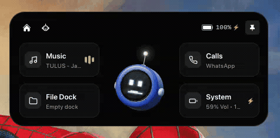
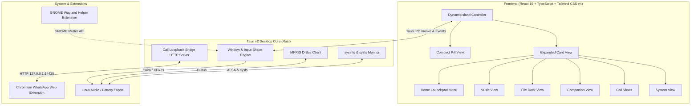

# 🤖 PIKO — Dynamic Island & Desktop Companion for Linux

<div align="center">

-orange?style=flat-square&logo=linux)


**Meet PIKO: A sleek, intelligent, and fluid dynamic island companion for Linux desktops.**  
*Inspired by modern mobile dynamic interfaces — re-engineered natively for GNOME, Wayland, and X11.*

<br/>



<p align="center">
  <sub>🎬 <i>Live showcase of PIKO on desktop.</i> &bull; <a href="public/piko.mp4"><b>Download / Watch HD MP4 Video</b></a></sub>
</p>

</div>

---

## 📖 Overview

**PIKO** is an intelligent Dynamic Island and persistent desktop companion that floats effortlessly at the top of your Linux screen. Built with **Tauri v2**, **React 19**, and **Rust**, PIKO integrates deeply with native Linux subsystems (D-Bus, MPRIS, sysfs, ALSA, and GNOME Shell) to provide instant HUD control over your music, system performance, drag-and-drop file staging, incoming WhatsApp Web calls, and an expressive, interactive desktop robot.

With true **input-shape masking**, PIKO allows mouse clicks to pass through completely to windows underneath while remaining fully interactive whenever you touch or hover over the island.

---

## ✨ Features

```
 +--------------------------------------------------------------------------+
 |  [◀ Prev]   [  🎵 Bohemian Rhapsody - Queen  ]   [|| Pause]   [Next ▶]   |
 |  [ 🏠 ]     [ 📂 File Dock (3) ]     [ ⚙️ 42% CPU | 78% RAM ]  [ 📌 Pin ] |
 +--------------------------------------------------------------------------+
```

### 🤖 Piko — The Autonomous Desktop Companion
- **Living Personality**: Piko is your expressive desktop companion living right inside the Dynamic Island.
- **9 Dynamic Facial Expressions**: Features `idle`, `happy`, `thinking`, `searching`, `listening`, `speaking`, `working`, `error`, and `sleeping` states rendered in ultra-crisp vector SVG.
- **Autonomous Gaze & Desktop Tracking**: Piko naturally glances around the screen (towards menus, user, diagonal) and locks gaze onto your cursor as you move it across the entire Linux desktop.
- **3-Way Dynamic Position Gliding**: In the Home Launchpad, Piko glides between Left, Center (splitting menu buttons 2-and-2), and Right positions with playful hop animations.
- **Interactive Poke & Bounces**: Click or poke Piko to trigger cheerful bounce animations and cycle expressions.
- **Video & GIF Showcase**: Watch Piko live in [piko.gif](public/piko.gif) and original HD [piko.mp4](public/piko.mp4).

### 🎵 MPRIS Media Controller
- **Universal Player Support**: Connects to Spotify, Chrome, Firefox, VLC, MPV, and any player adhering to the Linux D-Bus `org.mpris.MediaPlayer2` specification.
- **Rich Media HUD**: Displays album art, track title, artist name, and live playback state (`Playing`, `Paused`, `Stopped`).
- **Real-Time Animated Waveforms**: Responsive audio bar animations reflect playback activity.
- **Interactive Scrubber**: Seek through audio tracks with hover timestamp preview.
- **Playback Controls**: Full play/pause toggle, skip forward, skip backward, and source player identification.

### 📂 Temporary File Dock
- **Drag-Hover Auto-Expansion**: Dragging files from Nautilus, Nemo, Dolphin, or your desktop directly over the Dynamic Island automatically expands it into the File Dock.
- **Smart Rollback**: If you cancel or drag files away without dropping, the island smoothly returns to your previous active view and compact state with zero reload flicker.
- **Quick File Actions**: Copy absolute file paths, open items directly in the default system file manager, or clear individual files without deleting the source files from disk.
- **File Thumbnails & Metadata**: Formats file size, extension badges, and sanitized filenames cleanly.

### 📞 WhatsApp Web Call Bridge
- **Browser Extension Bridge**: Pairs with a dedicated Manifest V3 extension to intercept WhatsApp Web audio/video calls without touching chat messages.
- **Full Call HUD**: Live caller avatar, contact name, call status, and duration counter derived strictly from confirmed connection timestamps.
- **Swipe-to-Answer Slider**: Tactile, physics-based gesture slider with an 80% activation threshold and leftward safety clamping to prevent accidental triggers.
- **In-Call Actions**: Decline calls, mute microphone, and disconnect directly from the desktop island.
- **Secure Loopback Bridge**: High-entropy session tokens (`~/.config/dynamic-island/session.token`) with origin validation on `127.0.0.1:14425`.

### ⚙️ System Control Center
- **Hardware Telemetry**: Real-time CPU usage percentage and formatted RAM consumption (`used GB / total GB`).
- **ALSA Audio Slider**: Drag or scroll to adjust master system volume, complete with one-click mute toggling.
- **Battery & Power Monitor**: Live battery percentage, charging lightning indicator (`⚡`), and AC mains status via Linux sysfs.

### 🪟 Linux Wayland & X11 Engineering
- **True Transparency**: Custom GTK/Cairo input shape masking (`cairo_region_t` / XFixes) ensures that only the visible pill intercepts mouse clicks. The empty transparent window area remains 100% click-through to apps below.
- **GNOME Shell Wayland Extension**: Solves Wayland's `xdg_shell` restriction by keeping the island window strictly above other windows (`metaWindow.make_above()`) and sticky across all workspaces (`metaWindow.stick()`).
- **Window Pinning & Dragging**: Pin the island open for continuous monitoring, or reposition it smoothly using the dedicated drag handle.

---

## 🏗️ Architecture



---

## 📋 Prerequisites & System Requirements

- **Operating System**: Linux (Ubuntu 22.04 / 24.04+, Fedora 39+, Arch Linux, Debian 12+)
- **Desktop Environments**: GNOME (Wayland or X11), KDE Plasma, XFCE
- **System Dependencies**:
  ```bash
  # Debian / Ubuntu:
  sudo apt-get install -y libwebkit2gtk-4.1-dev build-essential curl wget file \
      libssl-dev libgtk-3-dev libayatana-appindicator3-dev librsvg2-dev libasound2-dev
  ```
- **Node.js**: v18.0.0 or later (Node 20+ recommended)
- **Rust**: 1.75.0 or later (`rustup default stable`)

---

## 🚀 Quick Start & Installation

### 1. Clone the Repository
```bash
git clone https://github.com/your-username/dynamic-island.git
cd dynamic-island
```

### 2. Install Frontend Dependencies
```bash
npm install
```

### 3. Run in Development Mode
To launch the desktop application with live reload:
```bash
npm run tauri dev
```

To run only the web interface in Vite:
```bash
npm run dev
```

### 4. Build for Production
To package a standalone Linux binary and Debian package:
```bash
npm run tauri build
```
The compiled binary will be located in:
`src-tauri/target/release/dynamic-island`

---

## 🧩 Optional Companion Extensions

### 1. GNOME Wayland Helper Extension
Under native Wayland, unprivileged applications cannot unilaterally force themselves above full-screen windows or appear across all workspaces. This extension grants Dynamic Island `keep-above` and `stick` capabilities inside Mutter:

```bash
# Install extension
mkdir -p ~/.local/share/gnome-shell/extensions/dynamic-island-helper@malakul-tech.com
cp gnome-extension/metadata.json gnome-extension/extension.js ~/.local/share/gnome-shell/extensions/dynamic-island-helper@malakul-tech.com/

# Enable extension
gnome-extensions enable dynamic-island-helper@malakul-tech.com
```

### 2. WhatsApp Web Call Bridge Extension (Chromium / Brave / Edge)
Intercepts incoming and active calls from WhatsApp Web and relays them to Dynamic Island:

1. Open `chrome://extensions/` in your browser.
2. Toggle on **Developer mode** in the upper right.
3. Click **Load unpacked** and select the [`browser-extension/`](file:///home/malakul-tech/project/dynamic-island/browser-extension) folder.
4. Obtain your local session token:
   ```bash
   cat ~/.config/dynamic-island/session.token
   ```
5. Click the extension icon in your browser toolbar, paste the session token, and click **Save & Test Connection**.

---

## 🧪 Testing

The project includes an automated unit test suite verifying the navigation state machine, swipe thresholds, call lifecycle progressions, file dock operations, and system formatting logic:

```bash
# Run unit tests
npm test

# Typecheck and asset build verification
npm run build
```

---

## 📁 Project Structure

```
dynamic-island/
├── browser-extension/         # Manifest V3 WhatsApp Web Call Bridge
│   ├── background.js          # Service worker relaying call events
│   ├── content.js             # MutationObserver for incoming calls
│   └── manifest.json          # Chrome extension manifest
├── gnome-extension/           # GNOME Shell Wayland window placement helper
│   ├── extension.js           # mutter window.make_above() & window.stick()
│   └── metadata.json          # GNOME Shell extension metadata
├── src/                       # React frontend
│   ├── assets/                # Visual icons and SVG assets
│   ├── components/            # UI Components
│   │   ├── DynamicIsland.tsx  # Master island controller & shape masking
│   │   ├── CompactView.tsx    # Sleek minimized pill view
│   │   ├── ExpandedView.tsx   # Maximized modal HUD shell
│   │   ├── HomeMenu.tsx       # 3-position launchpad with autonomous robot
│   │   ├── MusicView.tsx      # MPRIS player controls & waveforms
│   │   ├── FileDockView.tsx   # Drag-and-drop file shelf
│   │   ├── CompanionView.tsx  # Fullscreen interactive robot companion
│   │   ├── CallsView.tsx      # Unified call management interface
│   │   ├── IncomingCallView.tsx # Swipe-to-answer incoming call screen
│   │   ├── ActiveCallView.tsx # Live active call HUD with duration timer
│   │   └── SystemView.tsx     # CPU, RAM, Volume & Battery meters
│   ├── hooks/                 # Custom React hooks
│   │   ├── useSystemData.ts   # Hardware stats & MPRIS bridge
│   │   ├── useCallData.ts     # Call state machine & actions
│   │   └── useFileDock.ts     # Persistent shelf storage
│   ├── App.tsx                # App root
│   ├── App.css                # Global styles & keyframes
│   └── types.ts               # Shared TypeScript interfaces
├── src-tauri/                 # Rust Backend (Tauri v2)
│   ├── src/
│   │   ├── lib.rs             # Transparent window setup & GTK input shaping
│   │   ├── mpris.rs           # Linux D-Bus media player integration
│   │   ├── system.rs          # System stats (CPU, RAM, ALSA Volume)
│   │   ├── battery.rs         # sysfs battery / AC power monitor
│   │   └── call_bridge.rs     # Authenticated loopback HTTP server
│   └── tauri.conf.json        # Tauri configuration
└── tests/                     # Automated unit test suite
    ├── call_ui.test.ts        # Call UI and swipe gesture tests
    └── navigation.test.ts     # Navigation state machine & controls tests
```

---

## 🛡️ Security

- **Strict Loopback Binding**: The call bridge binds strictly to `127.0.0.1`. It never listens on public interfaces or LAN ports.
- **Session Token Authentication**: Every startup generates a cryptographically random session token required for extension handshakes.
- **No Disk Mutation on Docking**: The File Dock stores references only; removing or clearing files from the dock never touches files on your hard drive.
- **Privacy First**: The browser extension inspects only call notification DOM nodes on `web.whatsapp.com` and never reads chat history, messages, or keystrokes.

---

## 🤝 Contributing

Contributions, bug reports, and suggestions are welcome!

1. Fork the repository
2. Create your feature branch (`git checkout -b feature/amazing-feature`)
3. Commit your changes (`git commit -m 'feat: Add amazing feature'`)
4. Push to the branch (`git push origin feature/amazing-feature`)
5. Open a Pull Request

---

## 📄 License

This project is open-source and distributed under the **MIT License**. See the `LICENSE` file for details.

</div>

---

## 📖 Overview

**Dynamic Island for Linux** is a persistent desktop widget that floats seamlessly at the top of your screen. Built with **Tauri v2**, **React 19**, and **Rust**, it integrates directly with native Linux subsystems (D-Bus, MPRIS, sysfs, ALSA, and GNOME Shell) to provide instant control over your music, system performance, drag-and-drop files, incoming WhatsApp calls, and an interactive robot companion.

It features **input-shape masking**, allowing clicks to pass through completely to background windows while remaining fully interactive when interacting with the island pill.

---

## ✨ Features

```
 +--------------------------------------------------------------------------+
 |  [◀ Prev]   [  🎵 Bohemian Rhapsody - Queen  ]   [|| Pause]   [Next ▶]   |
 |  [ 🏠 ]     [ 📂 File Dock (3) ]     [ ⚙️ 42% CPU | 78% RAM ]  [ 📌 Pin ] |
 +--------------------------------------------------------------------------+
```

### 🎵 MPRIS Media Controller
- **Universal Player Support**: Connects to Spotify, Chrome, Firefox, VLC, MPV, and any player adhering to the Linux D-Bus `org.mpris.MediaPlayer2` specification.
- **Rich Media HUD**: Displays album art, track title, artist name, and live playback state (`Playing`, `Paused`, `Stopped`).
- **Real-Time Animated Waveforms**: Responsive audio bar animations reflect playback activity.
- **Interactive Scrubber**: Seek through audio tracks with hover timestamp preview.
- **Playback Controls**: Full play/pause toggle, skip forward, skip backward, and source player identification.

### 🤖 Autonomous Robot Companion
- **9 Dynamic Facial Expressions**: Features `idle`, `happy`, `thinking`, `searching`, `listening`, `speaking`, `working`, `error`, and `sleeping` expressions powered by vector SVG rendering.
- **Autonomous Looking & Gaze Tracking**: The robot naturally glances around the screen (towards menus, user, diagonal) and locks gaze onto the user's cursor across the entire desktop.
- **3-Way Dynamic Position Gliding**: In the Home Menu, the robot smoothly glides between Left, Center (splitting menu buttons 2-and-2), and Right positions with playful hop animations.
- **Interactive Bounce**: Click or poke the robot to trigger expressive bounces and cycle moods.

### 📂 Temporary File Dock
- **Drag-Hover Auto-Expansion**: Dragging files from Nautilus, Nemo, Dolphin, or your desktop directly over the Dynamic Island automatically expands it into the File Dock.
- **Smart Rollback**: If you cancel or drag files away without dropping, the island smoothly returns to your previous active view and compact state with zero reload flicker.
- **Quick File Actions**: Copy absolute file paths, open items directly in the default system file manager, or clear individual files without deleting the source files from disk.
- **File Thumbnails & Metadata**: Formats file size, extension badges, and sanitized filenames cleanly.

### 📞 WhatsApp Web Call Bridge
- **Browser Extension Bridge**: Pairs with a dedicated Manifest V3 extension to intercept WhatsApp Web audio/video calls without touching chat messages.
- **Full Call HUD**: Live caller avatar, contact name, call status, and duration counter derived strictly from confirmed connection timestamps.
- **Swipe-to-Answer Slider**: Tactile, physics-based gesture slider with an 80% activation threshold and leftward safety clamping to prevent accidental triggers.
- **In-Call Actions**: Decline calls, mute microphone, and disconnect directly from the desktop island.
- **Secure Loopback Bridge**: High-entropy session tokens (`~/.config/dynamic-island/session.token`) with origin validation on `127.0.0.1:14425`.

### ⚙️ System Control Center
- **Hardware Telemetry**: Real-time CPU usage percentage and formatted RAM consumption (`used GB / total GB`).
- **ALSA Audio Slider**: Drag or scroll to adjust master system volume, complete with one-click mute toggling.
- **Battery & Power Monitor**: Live battery percentage, charging lightning indicator (`⚡`), and AC mains status via Linux sysfs.

### 🪟 Linux Wayland & X11 Engineering
- **True Transparency**: Custom GTK/Cairo input shape masking (`cairo_region_t` / XFixes) ensures that only the visible pill intercepts mouse clicks. The empty transparent window area remains 100% click-through to apps below.
- **GNOME Shell Wayland Extension**: Solves Wayland's `xdg_shell` restriction by keeping the island window strictly above other windows (`metaWindow.make_above()`) and sticky across all workspaces (`metaWindow.stick()`).
- **Window Pinning & Dragging**: Pin the island open for continuous monitoring, or reposition it smoothly using the dedicated drag handle.

---

## 🏗️ Architecture


---

## 📋 Prerequisites & System Requirements

- **Operating System**: Linux (Ubuntu 22.04 / 24.04+, Fedora 39+, Arch Linux, Debian 12+)
- **Desktop Environments**: GNOME (Wayland or X11), KDE Plasma, XFCE
- **System Dependencies**:
  ```bash
  # Debian / Ubuntu:
  sudo apt-get install -y libwebkit2gtk-4.1-dev build-essential curl wget file \
      libssl-dev libgtk-3-dev libayatana-appindicator3-dev librsvg2-dev libasound2-dev
  ```
- **Node.js**: v18.0.0 or later (Node 20+ recommended)
- **Rust**: 1.75.0 or later (`rustup default stable`)

---

## 🚀 Quick Start & Installation

### 1. Clone the Repository
```bash
git clone https://github.com/vexeeldev/piko.git
cd dynamic-island
```

### 2. Install Frontend Dependencies
```bash
npm install
```

### 3. Run in Development Mode
To launch the desktop application with live reload:
```bash
npm run tauri dev
```

To run only the web interface in Vite:
```bash
npm run dev
```

### 4. Build for Production
To package a standalone Linux binary and Debian package:
```bash
npm run tauri build
```
The compiled binary will be located in:
`src-tauri/target/release/dynamic-island`

---

## 🧩 Optional Companion Extensions

### 1. GNOME Wayland Helper Extension
Under native Wayland, unprivileged applications cannot unilaterally force themselves above full-screen windows or appear across all workspaces. This extension grants Dynamic Island `keep-above` and `stick` capabilities inside Mutter:

```bash
# Install extension
mkdir -p ~/.local/share/gnome-shell/extensions/dynamic-island-helper@malakul-tech.com
cp gnome-extension/metadata.json gnome-extension/extension.js ~/.local/share/gnome-shell/extensions/dynamic-island-helper@malakul-tech.com/

# Enable extension
gnome-extensions enable dynamic-island-helper@malakul-tech.com
```

### 2. WhatsApp Web Call Bridge Extension (Chromium / Brave / Edge)
Intercepts incoming and active calls from WhatsApp Web and relays them to Dynamic Island:

1. Open `chrome://extensions/` in your browser.
2. Toggle on **Developer mode** in the upper right.
3. Click **Load unpacked** and select the [`browser-extension/`](file:///home/malakul-tech/project/dynamic-island/browser-extension) folder.
4. Obtain your local session token:
   ```bash
   cat ~/.config/dynamic-island/session.token
   ```
5. Click the extension icon in your browser toolbar, paste the session token, and click **Save & Test Connection**.

---

## 🧪 Testing

The project includes an automated unit test suite verifying the navigation state machine, swipe thresholds, call lifecycle progressions, file dock operations, and system formatting logic:

```bash
# Run unit tests
npm test

# Typecheck and asset build verification
npm run build
```

---

## 📁 Project Structure

```
dynamic-island/
├── browser-extension/         # Manifest V3 WhatsApp Web Call Bridge
│   ├── background.js          # Service worker relaying call events
│   ├── content.js             # MutationObserver for incoming calls
│   └── manifest.json          # Chrome extension manifest
├── gnome-extension/           # GNOME Shell Wayland window placement helper
│   ├── extension.js           # mutter window.make_above() & window.stick()
│   └── metadata.json          # GNOME Shell extension metadata
├── src/                       # React frontend
│   ├── assets/                # Visual icons and SVG assets
│   ├── components/            # UI Components
│   │   ├── DynamicIsland.tsx  # Master island controller & shape masking
│   │   ├── CompactView.tsx    # Sleek minimized pill view
│   │   ├── ExpandedView.tsx   # Maximized modal HUD shell
│   │   ├── HomeMenu.tsx       # 3-position launchpad with autonomous robot
│   │   ├── MusicView.tsx      # MPRIS player controls & waveforms
│   │   ├── FileDockView.tsx   # Drag-and-drop file shelf
│   │   ├── CompanionView.tsx  # Fullscreen interactive robot companion
│   │   ├── CallsView.tsx      # Unified call management interface
│   │   ├── IncomingCallView.tsx # Swipe-to-answer incoming call screen
│   │   ├── ActiveCallView.tsx # Live active call HUD with duration timer
│   │   └── SystemView.tsx     # CPU, RAM, Volume & Battery meters
│   ├── hooks/                 # Custom React hooks
│   │   ├── useSystemData.ts   # Hardware stats & MPRIS bridge
│   │   ├── useCallData.ts     # Call state machine & actions
│   │   └── useFileDock.ts     # Persistent shelf storage
│   ├── App.tsx                # App root
│   ├── App.css                # Global styles & keyframes
│   └── types.ts               # Shared TypeScript interfaces
├── src-tauri/                 # Rust Backend (Tauri v2)
│   ├── src/
│   │   ├── lib.rs             # Transparent window setup & GTK input shaping
│   │   ├── mpris.rs           # Linux D-Bus media player integration
│   │   ├── system.rs          # System stats (CPU, RAM, ALSA Volume)
│   │   ├── battery.rs         # sysfs battery / AC power monitor
│   │   └── call_bridge.rs     # Authenticated loopback HTTP server
│   └── tauri.conf.json        # Tauri configuration
└── tests/                     # Automated unit test suite
    ├── call_ui.test.ts        # Call UI and swipe gesture tests
    └── navigation.test.ts     # Navigation state machine & controls tests
```

---

## 🛡️ Security

- **Strict Loopback Binding**: The call bridge binds strictly to `127.0.0.1`. It never listens on public interfaces or LAN ports.
- **Session Token Authentication**: Every startup generates a cryptographically random session token required for extension handshakes.
- **No Disk Mutation on Docking**: The File Dock stores references only; removing or clearing files from the dock never touches files on your hard drive.
- **Privacy First**: The browser extension inspects only call notification DOM nodes on `web.whatsapp.com` and never reads chat history, messages, or keystrokes.

---

## 🤝 Contributing

Contributions, bug reports, and suggestions are welcome!

1. Fork the repository
2. Create your feature branch (`git checkout -b feature/amazing-feature`)
3. Commit your changes (`git commit -m 'feat: Add amazing feature'`)
4. Push to the branch (`git push origin feature/amazing-feature`)
5. Open a Pull Request

---

## 📄 License

This project is open-source and distributed under the **MIT License**. See the `LICENSE` file for details.

